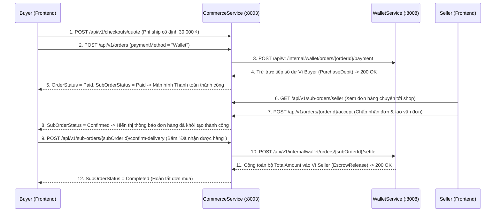

# Báo Cáo Triển Khai Luồng Thanh Toán Ví Nexus, Xử Lý Đơn Seller & Giải Ngân Khi Nhận Hàng

## 1. Tóm tắt luồng nghiệp vụ đã hoàn thiện & kiểm thử End-to-End

Toàn bộ luồng đã được triển khai đồng bộ trên **WalletService**, **CommerceService** và **Frontend (`nexus-dev`)**, đã build lại Docker container và kiểm thử thực tế qua API Gateway (`:8080`):

> [!TIP]
> **Kết quả kiểm thử End-to-End trực tiếp qua Gateway (`http://localhost:8080`)**:
> - **Ví Buyer trước thanh toán**: `19.771.000 ₫`
> - **Đặt mua sản phẩm** (`4.950.000 ₫`) + **Phí giao hàng cố định** (`30.000 ₫`) = **`4.980.000 ₫`**
> - **Tạo đơn bằng Ví Nexus (`ORD-20261104-F0EB1B`)**: Trạng thái `Paid`, **Ví Buyer trừ trực tiếp `-4.980.000 ₫`** (còn `14.791.000 ₫`).
> - **Đơn chuyển sang Seller (`SUB-20261104-7FAA2D`)**: Seller gọi `GET /api/v1/sub-orders/seller` thấy đơn `Paid`, bấm **Chấp nhận đơn** -> chuyển sang `Confirmed`.
> - **Buyer bấm "Đã nhận được hàng"**: Đơn chuyển sang `Completed`, **Ví Seller được cộng ngay `+4.980.000 ₫`** (từ `50.000.000 ₫` lên `54.980.000 ₫`).

---

## 2. Danh sách chi tiết các file code đã tạo mới và chỉnh sửa

### A. Backend — `WalletService` (`nexus-dev-be/WalletService`)

| STT | File code | Loại thay đổi | Nội dung chỉnh sửa |
| :--- | :--- | :--- | :--- |
| 1 | [PayOrderWithWalletCommand.cs](file:///c:/Users/wuann_/Desktop/new-nexus/nexus-dev-be/WalletService/Wallet.Application/Features/Checkout/Commands/PayOrderWithWallet/PayOrderWithWalletCommand.cs) | **Tạo mới** | Định nghĩa command `PayOrderWithWalletCommand` nhận `OrderId`, `UserId`, `Amount`, `IdempotencyKey` để trừ tiền ví người mua khi đặt hàng. |
| 2 | [PayOrderWithWalletCommandHandler.cs](file:///c:/Users/wuann_/Desktop/new-nexus/nexus-dev-be/WalletService/Wallet.Application/Features/Checkout/Commands/PayOrderWithWallet/PayOrderWithWalletCommandHandler.cs) | **Tạo mới** | Khóa dòng ví người mua (`LockWalletByUserIdAsync`), kiểm tra idempotency theo `(ReferenceId = OrderId, Type = PurchaseDebit)`, trừ tiền khả dụng (`wallet.Deduct`) và lưu giao dịch `PurchaseDebit`. |
| 3 | [SettleSellerOrderCommand.cs](file:///c:/Users/wuann_/Desktop/new-nexus/nexus-dev-be/WalletService/Wallet.Application/Features/Checkout/Commands/SettleSellerOrder/SettleSellerOrderCommand.cs) | **Tạo mới** | Định nghĩa command `SettleSellerOrderCommand` nhận `SubOrderId`, `SellerUserId`, `Amount`, `SubOrderNo` để giải ngân tiền đơn hàng vào ví Seller. |
| 4 | [SettleSellerOrderCommandHandler.cs](file:///c:/Users/wuann_/Desktop/new-nexus/nexus-dev-be/WalletService/Wallet.Application/Features/Checkout/Commands/SettleSellerOrder/SettleSellerOrderCommandHandler.cs) | **Tạo mới** | Tự động đảm bảo ví Seller tồn tại (`EnsureWalletCommand`), khóa ví Seller, kiểm tra idempotency theo `(ReferenceId = SubOrderId, Type = EscrowRelease)`, cộng toàn bộ tiền đơn (`sellerWallet.Deposit`) và lưu lịch sử giao dịch `EscrowRelease`. |
| 5 | [WalletsController.cs](file:///c:/Users/wuann_/Desktop/new-nexus/nexus-dev-be/WalletService/Wallet.Api/Controllers/Public/WalletsController.cs) | **Chỉnh sửa** | Mở 2 endpoint nội bộ cho `CommerceService`: `POST /api/v1/internal/wallet/orders/{orderId:guid}/payment` và `POST /api/v1/internal/wallet/orders/{subOrderId:guid}/settle`. |
| 6 | [HttpContextExtensions.cs](file:///c:/Users/wuann_/Desktop/new-nexus/nexus-dev-be/WalletService/Wallet.Api/Extensions/HttpContextExtensions.cs) | **Chỉnh sửa** | Bổ sung fallback trích xuất `sub`/`nameid`/`userId` từ JWT Bearer token khi gọi nội bộ giữa các service mà không đi qua Gateway header `x-user-id`. |

---

### B. Backend — `CommerceService` (`nexus-dev-be/CommerceService`)

| STT | File code | Loại thay đổi | Nội dung chỉnh sửa |
| :--- | :--- | :--- | :--- |
| 7 | [IWalletClient.cs](file:///c:/Users/wuann_/Desktop/new-nexus/nexus-dev-be/CommerceService/Commerce.Application/Interfaces/IWalletClient.cs) | **Chỉnh sửa** | Bổ sung phương thức `SettleSellerOrderAsync` vào hợp đồng tích hợp `IWalletClient`. |
| 8 | [WalletClient.cs](file:///c:/Users/wuann_/Desktop/new-nexus/nexus-dev-be/CommerceService/Commerce.Infrastructure/Services/Wallet/WalletClient.cs) | **Chỉnh sửa** | Triển khai `SettleSellerOrderAsync` gọi `POST /api/v1/internal/wallet/orders/{subOrderId}/settle` sang `WalletService`. |
| 9 | [IOrderService.cs](file:///c:/Users/wuann_/Desktop/new-nexus/nexus-dev-be/CommerceService/Commerce.Application/Services/Order/IOrderService.cs) | **Chỉnh sửa** | Khai báo thêm 2 nghiệp vụ `ListSellerSubOrdersAsync` (danh sách đơn của Seller) và `BuyerConfirmDeliveryAsync` (Buyer xác nhận đã nhận hàng). |
| 10 | [OrderService.cs](file:///c:/Users/wuann_/Desktop/new-nexus/nexus-dev-be/CommerceService/Commerce.Application/Services/Order/OrderService.cs) | **Chỉnh sửa** | - Áp dụng phí giao hàng mặc định cố định `30.000 ₫` trong `QuoteCheckoutAsync` và hỗ trợ địa chỉ hành chính 2 cấp. - Triển khai `ListSellerSubOrdersAsync` lọc `SubOrder` theo `SellerId`. - Triển khai `BuyerConfirmDeliveryAsync`: chuyển `SubOrder.Status = SubOrderStatus.Completed` và gọi `_walletClient.SettleSellerOrderAsync` cộng toàn bộ `so.TotalAmount` vào ví Seller. |
| 11 | [OrdersController.cs](file:///c:/Users/wuann_/Desktop/new-nexus/nexus-dev-be/CommerceService/Commerce.Api/Controllers/Public/OrdersController.cs) | **Chỉnh sửa** | Bổ sung 2 API: - `GET /api/v1/sub-orders/seller` (Danh sách đơn bán cho Seller) - `POST /api/v1/sub-orders/{subOrderId:guid}/confirm-delivery` (Buyer xác nhận đã nhận hàng & giải ngân ví Seller). |

---

### C. Frontend — `nexus-dev` (`nexus-dev/src`)

| STT | File code | Loại thay đổi | Nội dung chỉnh sửa |
| :--- | :--- | :--- | :--- |
| 12 | [BuyerCommerceScreens.tsx](file:///c:/Users/wuann_/Desktop/new-nexus/nexus-dev/src/features/commerce/BuyerCommerceScreens.tsx) | **Chỉnh sửa** | - **`CartScreen` & `CheckoutScreen`**: Hiển thị phí vận chuyển cố định **`30.000 ₫`**, loại bỏ hoàn toàn COD, chỉ sử dụng **Ví trên nền tảng (Ví Nexus)** kèm kiểm tra số dư khả dụng trực tiếp. - **Màn hình Thanh toán thành công**: Sau khi trừ ví thành công (`Paid`), hiển thị màn hình xác nhận đơn hàng sẽ sớm được giao, số tiền đã bị trừ trên ví và đơn đã chuyển đến Seller. - **`OrdersScreen` & `OrderDetailScreen`**: Hiển thị thông báo khi Seller chấp nhận đơn (*"Đơn hàng đã được khởi tạo thành công"*) và nút **"Đã nhận được hàng"** để xác nhận nhận hàng & chuyển toàn bộ tiền đơn hàng vào ví Seller. |
| 13 | [SellerScreens.tsx](file:///c:/Users/wuann_/Desktop/new-nexus/nexus-dev/src/features/seller/SellerScreens.tsx) | **Chỉnh sửa** | - **`SellerOrdersScreen`**: Kết nối `GET /api/v1/sub-orders/seller`, hiển thị danh sách đơn hàng chuyển đến shop và nút **"Chấp nhận đơn"** (`POST /api/v1/orders/{orderId}/accept`). - **`SellerOrderDetailScreen`**: Kết nối `GET /api/v1/sub-orders/{id}`, hiển thị chi tiết sản phẩm, người nhận, phí giao hàng `30.000 ₫` và cho phép **Chấp nhận đơn** / **Từ chối đơn**. |
| 14 | [WalletScreen.tsx](file:///c:/Users/wuann_/Desktop/new-nexus/nexus-dev/src/features/wallet/WalletScreen.tsx) | **Chỉnh sửa** | Bổ sung nhãn tiếng Việt cho loại giao dịch `ESCROWRELEASE` (*"Nhận tiền đơn hàng"*), `PURCHASEDEBIT` (*"Thanh toán đơn hàng"*), cột nội dung (`note`) và chuẩn hóa kiểm tra trạng thái ví `ACTIVE`. |
| 15 | [WalletOperationsScreens.tsx](file:///c:/Users/wuann_/Desktop/new-nexus/nexus-dev/src/features/wallet/WalletOperationsScreens.tsx) | **Chỉnh sửa** | Kết nối **`SellerWalletScreen`** (`/seller/wallet`) với `walletService.getBalance()` và `walletService.getTransactions()` để Seller thấy ngay số dư khả dụng và lịch sử cộng tiền đơn hàng (`EscrowRelease`) sau khi Buyer bấm nhận hàng thành công. |
| 16 | [globals.css](file:///c:/Users/wuann_/Desktop/new-nexus/nexus-dev/src/styles/globals.css) | **Chỉnh sửa** | Bổ sung style cho `.checkout-payment-box`, `.checkout-success-card`, `.checkout-success-badge` và `.order-status-banner`. |
